# Hotel Pricing System - Architecture Document

### 1.- Introduction

This document defines the proposed replacement HPS for approximately 300 hotels. It is the consolidated result of five ADD 3.0 design iterations, prepared on 2026-10-16. See [preparation](preparation.md), [iteration plan](iteration-plan.md) and [validation plan](validation-plan.md). This is a design, not an implemented or benchmarked system. Open acceptance definitions prevent claiming quantitative quality scenarios as proven.

Use a modular Java application with an Angular browser UI, managed relational storage and a separately scaled delivery worker. Keep synchronous calculation and atomic publication inside one application transaction; isolate external delivery from that transaction. This reduces distributed coordination within the two-month MVP constraint while preserving explicit boundaries for future change. A managed container runtime is the baseline; Kubernetes, event sourcing and a general rules platform are not justified by the available workload or team information.

### 2.- Context diagram

HPS owns hotel pricing and hotel-scoped permissions. Cloud identity owns authentication and credentials. Existing enterprise systems query prices using REST; CMS receives durable asynchronous pushes over REST. Enterprise Reservation System is included because it appears in the business narrative.

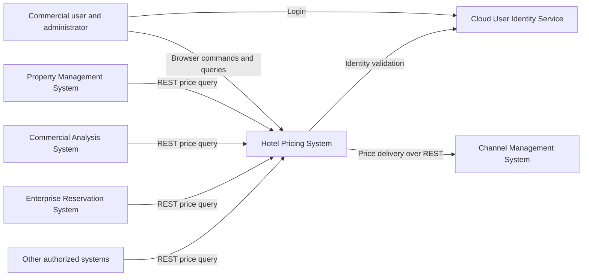

### 3.- Architectural drivers

The immutable source is [architectural-drivers.md](../architectural-drivers.md). Interpretations are recorded separately in preparation.md.

| User story | Scope | Priority |
|---|---|---|
| HPS-1 | Cloud identity login and hotel authorization | Supporting prerequisite |
| HPS-2 | Simulate and change base/fixed prices, derive rates, publish and deliver | Primary |
| HPS-3 | Browser and external price queries | Primary |
| HPS-4 | Hotel, tax, room and rate configuration | Primary |
| HPS-5 | Rate definitions and calculation rules | Supporting prerequisite |
| HPS-6 | Change user permissions | Supporting prerequisite |

| Scenario | Target | Priority |
|---|---|---|
| QA-1 | Full hotel/date price set queryable in less than 100 ms after change | High |
| QA-2 | All accepted changes published and received by CMS | High |
| QA-3 | Query uptime 99.9% outside maintenance | High |
| QA-4 | 100,000 to 1,000,000 daily API queries; provisional mean-latency increase at most 20% | High |
| QA-5 | Cloud identity and authorized operations only | High |
| QA-6 | New query protocol without changing core | Medium |
| QA-7 | Environment promotion without code changes | Medium |
| QA-8 | Complete publication performance and reliability measures | Medium |
| QA-9 | Every element independently integration-testable without external systems | Medium |

| Constraint | Architectural response |
|---|---|
| CON-1 | Responsive browser application; Windows, macOS and Linux browser matrix |
| CON-2 | Cloud hosting and existing cloud identity; no local credential database |
| CON-3 | Existing proprietary Git platform and its compatible pipeline runner |
| CON-4 | Working MVP within two months and release within six months; relative schedule |
| CON-5 | REST first, isolated protocol adapters |
| CON-6 | Managed cloud runtime, database, secrets and monitoring |

| Concern | Architectural response |
|---|---|
| CRN-1 | Explicit containers and module ownership |
| CRN-2 | Java application and Angular UI |
| CRN-3 | Responsibility allocation in iteration plan |
| CRN-4 | Versioned contracts, automated boundaries, ADRs and controlled schema evolution |
| CRN-5 | Immutable artifacts, environment configuration and automated promotion |

### 4.- Domain model

This conceptual model describes business relationships, not deployment units. Publication and Delivery are design-introduced concepts that make reliability explicit.

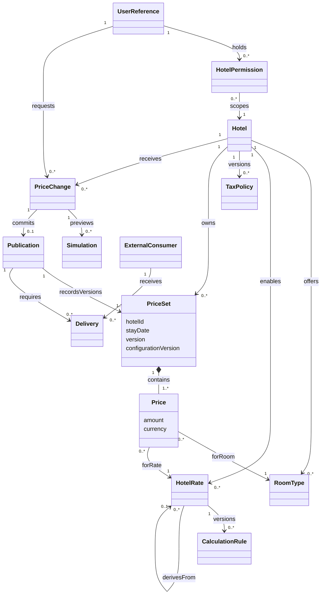

| Element | Responsibility and invariant |
|---|---|
| Hotel | Configuration and access scope; incomplete hotels cannot publish prices |
| RoomType | Hotel-owned room category; referenced history is retired, not deleted |
| HotelRate | Base, fixed or derived rate; fixed rates have no parent; derived graph must be acyclic |
| CalculationRule | Versioned restricted arithmetic expression; no arbitrary Java or remote calls |
| TaxPolicy | Versioned effective-date policy with explicit inclusion and rounding rules |
| PriceSet | Complete version for a hotel/date with configuration version; all entries become visible together |
| Price | Decimal money amount in an explicit currency for one room/rate combination |
| PriceChange | One hotel's bounded set of date edits, expected versions and idempotency key |
| Simulation | Pure preview using the same calculator as commit; never creates authoritative prices or delivery work |
| UserReference | Cloud identity subject; stores no password |
| HotelPermission | Subject, hotel and allowed operations; administrator scope is explicit |
| Publication | Immutable committed change and exact price-set versions, actor and timing metadata |
| Delivery | Consumer/publication pair with state, attempt history and acknowledgement |
| ExternalConsumer | Contract and authorization scope; only CMS initially requires pushed delivery |

Configuration edits create draft versions. Activation impacting existing prices requires explicit recalculation of affected dates; existing price sets retain their previous policy version until that recalculation commits. Never silently reinterpret an old amount using a new tax or rule. Effective-date scope, monetary rounding and tax treatment require business confirmation before implementation.

### 5.- Container diagram

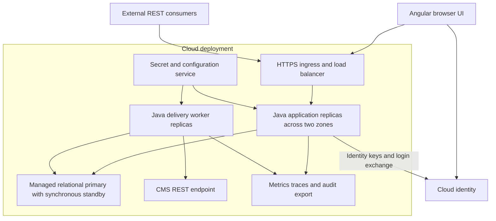

| Container | Responsibilities and deployment |
|---|---|
| Angular UI | Login redirect, scoped hotel administration, preview and queries; static cloud hosting |
| HTTPS ingress | TLS termination, request limits and load balancing; no business authorization ownership |
| Java application | Browser authentication backend, authorization, configuration, pricing and query modules; stateless replicas with shared session storage |
| Relational database | Prices, configuration, entitlements, sessions, command receipts, publications and delivery queue; HPS-only ownership |
| Delivery worker | Leased durable delivery tasks, bounded retries, CMS adapter and reconciliation; independently deployable from request replicas |
| Telemetry | Dashboards and alerts; durable database records remain the authoritative publication measurement ledger |
| Secrets/configuration service | Environment-specific endpoints, credentials and configuration; workload identities where supported |

Database tables are shared only by HPS-owned modules and the HPS worker under explicit ownership and least-privilege roles. External applications receive neither SQL access nor shared schemas. A broker is not necessary initially: committed delivery rows are the durable queue. Introduce a broker only if measured polling/throughput or additional consumers justify the added operations and retain the transactional publication boundary.

All API replicas initially read the authoritative primary. This protects immediate queryability after commit and avoids replica-lag ambiguity. The standby is for failover, not routine reads. Multi-zone deployment has a recurring cost; regional disaster recovery remains a separately costed decision pending RTO/RPO.

### 6.- Component diagrams

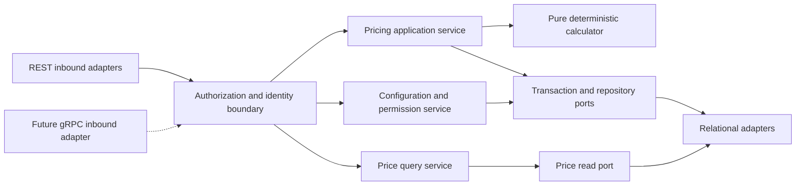

| Component | Responsibilities |
|---|---|
| REST inbound adapters | Parse transport DTOs, validate bounds, map errors and propagate request identity |
| Authorization/identity boundary | Validate session or access token and current hotel/operation entitlements; fail closed |
| Pricing application service | Preview and commit orchestration, expected-version checks and atomic publication |
| Calculator | Decimal arithmetic, dependency order, policy version and deterministic output |
| Price query service | Bounded authorized queries and complete versioned price-set results |
| Configuration/permission service | Hotel/rate validation, version activation, entitlements and administrator audit |
| Transaction/repository ports | Atomic storage contract, concurrency checks and idempotent command receipt |
| Price read port | Protocol-neutral query model and pagination snapshot semantics |
| Relational adapters | SQL, indexing and persistence-specific mapping; own no pricing rules |

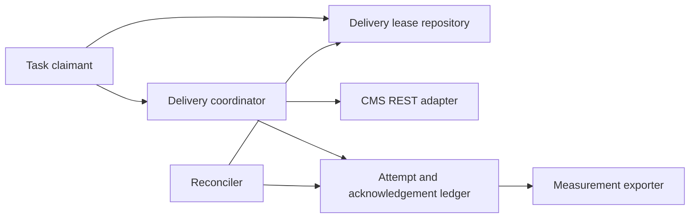

| Worker component | Responsibilities |
|---|---|
| Task claimant and lease repository | Claim eligible work with expiring leases and fencing tokens; one in-flight sequence per hotel/consumer |
| Delivery coordinator | Timeout, retry classification, backoff and per-consumer circuit breaker |
| CMS REST adapter | Map immutable publication payload to negotiated receiver contract |
| Attempt/acknowledgement ledger | Persist each intent and observed outcome; timeouts are unknown outcomes, not confirmed failures |
| Reconciler | Recover expired claims, compare acknowledgements, alert blocked work and redrive safely |
| Measurement exporter | Export unsampled publication ledger records using durable checkpoints and deduplication |

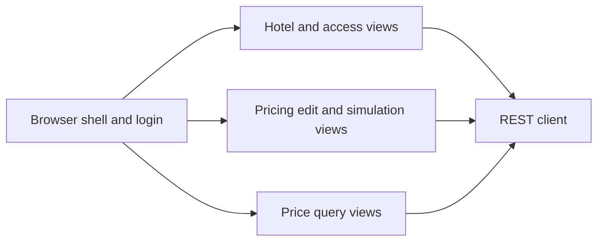

| Browser component | Responsibility |
|---|---|
| Shell/login | Redirect to identity service and maintain secure server session |
| Hotel/access views | Authorized configuration and permission editing |
| Pricing views | Explicit preview, conflict reporting and confirmed version display |
| Query views | Date/rate filtering and version display |
| REST client | Request correlation and consistent error handling; UI checks do not replace server checks |

### 7.- Sequence diagrams

#### 7.1 Login and permission changes — HPS-1, HPS-6, QA-5

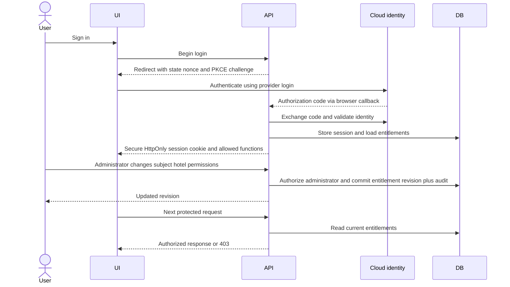

Use the provider login window rather than collecting passwords in HPS. Validate issuer, audience, signature, expiry, state and nonce as applicable. Browser sessions require CSRF protection and secure cookie settings. External systems use scoped machine access tokens, not browser cookies. Entitlements are read authoritatively on each request; revocation affects requests authorized after the change commits. Already authorized in-flight requests may complete, a boundary requiring confirmation. This follows the authentication model in [OpenID Connect Core](https://www.openid.net/specs/openid-connect-core-1_0.html); HPS authorization remains application-specific.

#### 7.2 Hotel and rate management — HPS-4, HPS-5

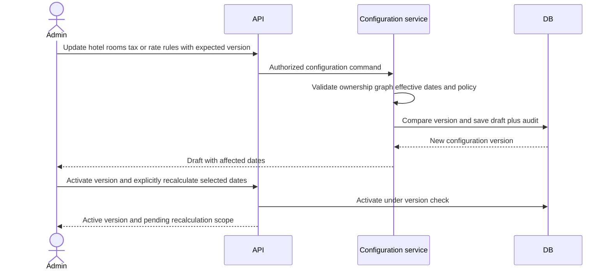

Recalculation uses the price-change workflow below and pins the selected configuration. Activation does not rewrite historical prices. Retiring a referenced room/rate preserves historical identifiers; new publications validate currently effective configuration.

#### 7.3 Simulation and atomic publication — HPS-2, QA-1, QA-2

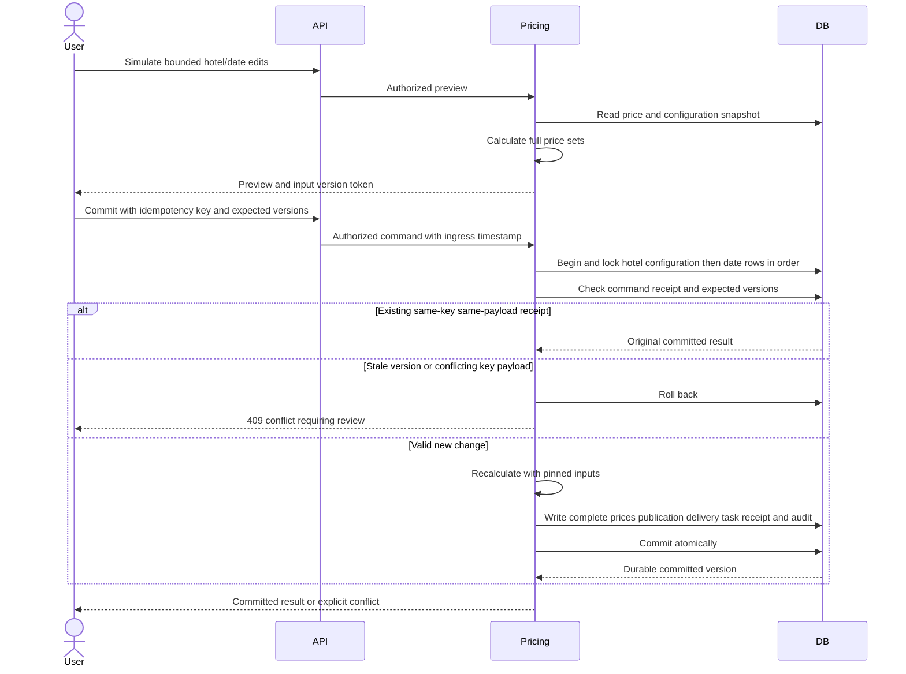

The commit response is successful only after durable commit. Simulation never publishes. A unique subject/hotel/idempotency-key constraint plus request hash prevents duplicate commits after a lost response. The receipt, price sets, immutable publication payload and CMS delivery task share one transaction. Publication timing ends at successful database commit, not at CMS receipt. Requests rejected before commit are not accepted changes.

Transactions serialize overlapping hotel/date updates using deterministic locks and version checks. Hotel configuration edits follow the same lock order. Use a single query snapshot for complete results; multi-query responses use a repeatable snapshot or immutable publication version. Default read-committed statements alone do not guarantee a consistent multi-statement snapshot; see [PostgreSQL transaction isolation](https://www.postgresql.org/docs/14/transaction-iso.html).

Provisional engineering budget for one hotel/date: ingress and authorization 15 ms, input lookup and lock acquisition 15 ms, calculation 20 ms, atomic write/commit 35 ms, contingency 15 ms. This is a target allocation, not evidence; the sum is 100 ms and actual acceptance must remain strictly below 100 ms. Reject oversized synchronous requests with an explicit limit; negotiate limits before implementation. Multi-date changes remain bounded and all-or-nothing. Heavy bulk imports use a separately specified workflow and cannot silently weaken QA-1.

#### 7.4 Delivery and recovery — HPS-2, QA-2, QA-8

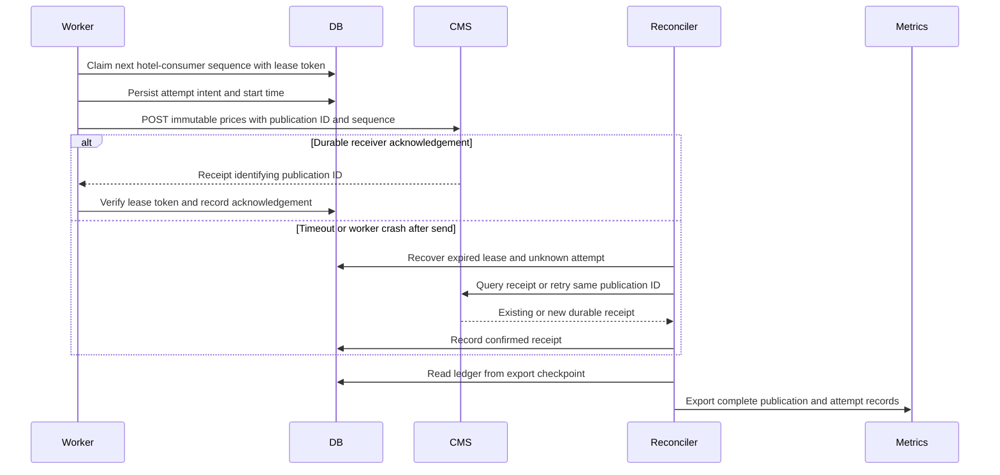

This is at-least-once delivery with receiver deduplication, not a claim of distributed exactly-once delivery. The transactional publication/task mechanism avoids a database/network dual-write gap; [AWS transactional outbox guidance](https://docs.aws.amazon.com/prescriptive-guidance/latest/cloud-design-patterns/transactional-outbox.html) documents that principle and the need for duplicate handling. This citation does not select AWS as the hosting vendor.

Never mark work delivered on an unqualified HTTP acceptance response. A 202 requires receipt polling unless the agreed contract explicitly means durable receipt. Retry transient errors with exponential backoff, jitter and a bounded concurrent sender pool. Authentication and validation failures enter a visible blocked state for repair; records are not discarded after a retry count. Strict per-hotel order means a blocked event stalls later events for that hotel; other hotels continue. Receiver sequence checks and idempotency are required to prevent a delayed old request overwriting newer prices after lease expiry. If CMS lacks these capabilities, QA-2 remains partial and requires a negotiated adapter/receipt mechanism; local sender logic alone cannot prove receipt.

#### 7.5 Query and failover — HPS-3, QA-3, QA-4

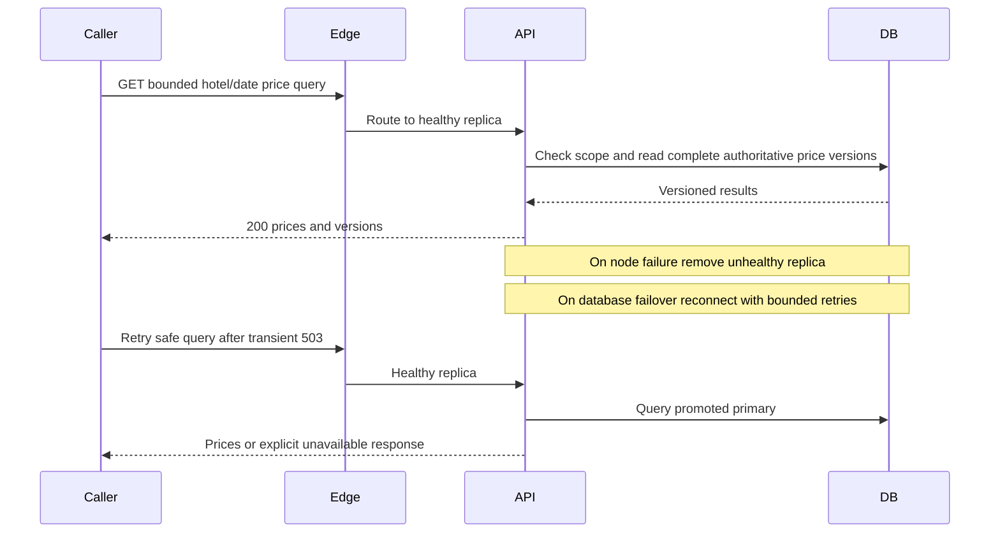

Deploy at least two application replicas across zones and a managed synchronous database standby. Apply readiness probes, bounded timeouts, connection pool limits, request admission and graceful drain. Reserve a query connection/concurrency budget so bulk writes and delivery polls cannot consume all query capacity. CMS outages do not block queries. Identity outages can prevent new logins; valid existing sessions and cached valid signing keys may continue within their validity, while unknown keys fail closed. Database failures remain query failures until failover completes and count against availability.

100,000/day is approximately 1.16 queries/second on average; 1,000,000/day is 11.57. These averages do not specify peaks. Test a provisional 10-times-average peak, approximately 116 queries/second at the high volume, and replace it with observed/confirmed demand. Index prices by hotel, stay date, room and rate, bound date spans, use keyset pagination pinned to a version, and autoscale API replicas on saturation/latency. Do not infer database capacity from API replica count. Add caches or read replicas only with explicit consistency semantics and measured need.

For a provisional 30-day accounting period, 99.9% allows 43.2 minutes of unavailability before maintenance exclusions. The period and exclusion rules are not approved. Measure eligible query availability and count failover, dependency failures and overload responses; show excluded maintenance separately. Regional recovery targets and backup retention remain open.

#### 7.6 Protocol extension and isolated testing — QA-6, QA-9

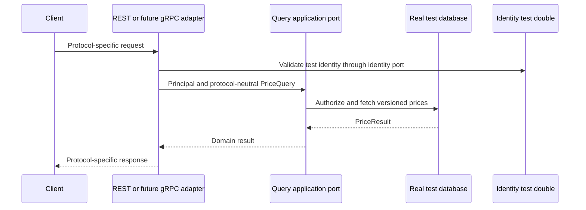

Core types contain no REST, gRPC, SQL or identity SDK classes. Add protocol mapping and composition-root wiring without changing core source. Integration tests use a real disposable database and deterministic identity/CMS simulators; staging also runs against external test systems to detect gaps in mocks.

#### 7.7 Environment promotion — QA-7, CON-3, CRN-5

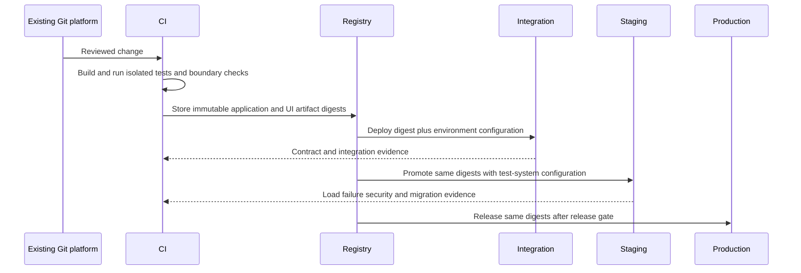

Local development uses the same interfaces with disposable dependencies. Integration substitutes unavailable external systems; staging uses all external test systems; production uses live endpoints. Angular runtime configuration is loaded separately rather than compiled per environment. Keep secrets out of artifacts. Use expand/contract database migrations so old/new replicas overlap safely; rollback application artifacts while retaining compatible schema, and postpone destructive schema removal until rollback windows close.

### 8.- Interfaces

These are proposed architecture contracts; concrete OpenAPI/schema definitions and consumer negotiation are implementation deliverables.

| Interface | Inputs and result | Guarantees and errors |
|---|---|---|
| POST /v1/hotels/{hotelId}/price-simulations | Date edits, expected configuration; returns price sets and input-version token | Authorization required; no authoritative price/delivery side effects; 422 invalid rule |
| POST /v1/hotels/{hotelId}/price-changes | Idempotency-Key, expected price/config versions, date edits | 201 committed publication ID and versions; replay returns original result; 409 stale version or key misuse; 413 exceeds negotiated bound |
| GET /v1/hotels/{hotelId}/prices | Bounded dates, optional rate/room filters and version cursor | 200 explicit currency, policy version and complete snapshot; 404 absent price; no invented zero amount |
| GET /v1/publications/{id} | Authorized publication identifier | Publication state and CMS status; scope checked against owning hotel |
| Configuration REST resources | Versioned hotels, rooms, tax policies and rate rules | Administrator and hotel scope; optimistic concurrency; no destructive deletion of referenced history |
| Permission REST resource | Cloud subject, hotel, allowed operations, expected entitlement revision | Authorized administrator; atomic revision/audit; cannot grant outside administrator scope |
| PriceQuery application port | Principal, HotelId, date interval and filters | Protocol-neutral PriceResult or typed domain errors; authorization remains in core application boundary |
| Pricing transaction port | Expected versions, calculated sets, publication, receipt and task | Atomic commit or no accepted change; storage failures propagate explicitly |
| CMS publication contract | Schema version, publication ID, hotel sequence, exact immutable price sets, currency, configuration versions and checksum | Durable receipt identifies publication; deduplicate by ID; enforce sequence; 202 receipt semantics negotiated |
| Publication measurement record | Request ID, ingress timestamp, commit outcome, elapsed time, publication ID, attempt/receipt timestamps | Unsampled durable ledger and resumable export; distinguish unknown from failed outcomes |

All public endpoints use TLS, authenticated principals, payload limits and current hotel/operation authorization. Return 401 for missing/invalid identity, 403 for disallowed scope, 409 for concurrency conflicts, 422 for domain invalidity, 429 for throttling and 503 for temporary dependency failure. Do not disclose other hotels' data through error bodies. Amounts use decimal strings and ISO currency identifiers; dates are hotel-local stay dates, while audit instants are UTC. Currency conversion is outside the supplied scope.

Partition concurrency and delivery ordering by hotel. Publication IDs are globally unique, and each publication stores an immutable payload so retry does not accidentally send today's newer prices for an old change. A multi-date request has one publication referencing all committed sets. Pagination across mutable data uses a bounded-lived version snapshot; expiry returns an explicit restart-required error. Receipt and publication retention must cover the agreed replay/recovery horizon; archive before pruning and retain durable reconciliation watermarks.

### 9.- Design decisions

| ID / Driver | Decision | Rationale | Discarded alternatives |
|---|---|---|---|
| D1 / CRN-1, CRN-2, CON-4 | Angular plus modular Java application and separate delivery worker | Familiar technology, small initial deployment surface and clear ownership | Per-domain microservices initially: network transactions and operational burden |
| D2 / HPS-1, HPS-6, QA-5, CON-2 | Cloud login and server-enforced current hotel entitlements | Credentials remain with provider; UI and API share access policy | UI-only checks or custom password store: inadequate trust boundary |
| D3 / HPS-2, HPS-4, HPS-5, QA-1 | Pure versioned calculator, bounded synchronous calculation, decimal money | Preview/commit parity and predictable request work | Remote rules engine and asynchronous-only projection: latency/consistency risk |
| D4 / QA-1, QA-2, CRN-4 | Atomic prices, publication payload, delivery task and command receipt | No accepted update without queryable prices and recoverable delivery work | Separate database and HTTP writes: loss gap |
| D5 / HPS-3, QA-1, QA-4 | Primary-store queries and indexed complete price sets | Immediate committed visibility without cache invalidation | Unqualified replica or cache reads: stale prices |
| D6 / QA-2, CON-5 | Leased REST delivery, receiver idempotency and receipt reconciliation | Isolates external failures and makes ambiguous outcomes recoverable | Synchronous CMS dependency or claimed exactly-once HTTP: unsupported |
| D7 / QA-8 | Durable unsampled publication/attempt ledger and checkpointed export | Detects missing measurements and allows replay | Sampled traces alone: cannot demonstrate completeness |
| D8 / QA-3, QA-4, CON-6 | Multi-zone replicas and database standby, query resource reservations | Reduces single-node failures and workload interference | Single-zone deployment; premature multi-region active-active complexity |
| D9 / QA-6, QA-9, CON-5 | Application ports and isolated protocol/persistence adapters | New transports and test doubles avoid core edits | Transport/SDK types in core: tight coupling |
| D10 / QA-7, CON-3, CRN-5 | Build once, runtime config, same digest promotion, compatible migrations | Reproducible releases without environment-specific code | Rebuild per environment or simultaneous breaking schema deployment |
| D11 / CRN-3, CRN-4, CON-4 | Module owners, contract review, staged delivery and measured release gates | Aligns scope with delivery windows and exposes uncertainty | Speculative platform expansion or deadline promises without staffing |
| D12 / HPS-2, QA-2, CRN-4 | Snapshot migration, price reconciliation and controlled source cutover | Avoids two systems accepting conflicting authoritative edits | Uncoordinated dual writes and unverified bulk import |

Design trade-offs and alternatives are expanded in iteration-1.md through iteration-5.md. Satisfaction assessments there refer to design coverage, not passed runtime tests. QA-1 through QA-4, QA-8 and receiver-dependent QA-2 remain conditional; see validation-plan.md for acceptance gates and residual risks.
