# Hotel Pricing System - Architecture Document

### 1.- Introduction

This is the consolidated ADD 3.0 design resulting from Iterations 1 through 5, completed on 2026-10-14. It replaces the legacy HPS within the boundary described in [architectural drivers](../architectural-drivers.md). The [iteration plan](iteration-plan.md) and individual iteration records preserve refinement rationale. The user's instruction to proceed through the final iteration supersedes the skill's intermediate review pauses; it does not establish stakeholder acceptance of provisional business assumptions.

The baseline is an Angular browser application, a Java modular application with separate query and command runtime pools, an independently deployed Java delivery worker, and one HPS-owned managed relational database. External systems use REST; the CMS receives durable asynchronous deliveries through its REST adapter. A broker, distributed microservices and a separate eventually consistent query database are not required for the initial release. These are design decisions, not implemented or benchmarked capabilities.

Scope includes pricing, configuration, authorization integration, query and publication contracts, deployment, operations and verification. External-system redesign and cloud procurement are excluded. Java framework, managed platform and supported component versions must be pinned during implementation on the existing cloud provider. No vendor purchase or infrastructure deployment has been performed.

### 2.- Context diagram

The following preserves the supplied context: users submit price changes, HPS supplies prices to business systems, and the cloud identity service validates identities. Arrows describe business information flow, not necessarily the initiator of a network connection. The source credentials arrow is conceptual; the refined login flow uses a redirect to the identity provider rather than collecting passwords in HPS.

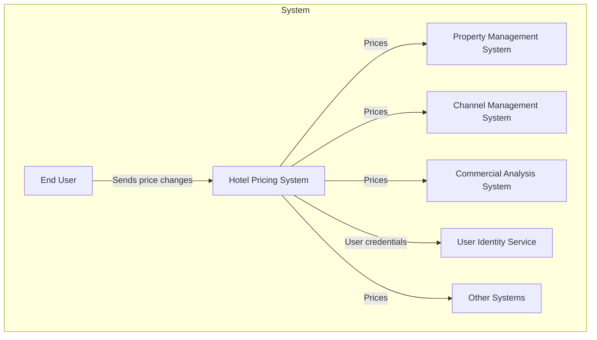

The Enterprise Reservation System mentioned in the business case is treated as an external query consumer pending its contract definition. Direct travel-agency integration remains the CMS's responsibility. External consumers never access the HPS database.

### 3.- Architectural drivers

#### User stories

| Driver | Requirement summary | Priority and refinement |
|---|---|---|
| HPS-1 | Login through cloud identity; hotel-scoped access. | Supporting prerequisite; Iteration 2. |
| HPS-2 | Simulate and change base/fixed prices, calculate derived rates, publish to queries and CMS. | Primary business driver; Iterations 1-3. |
| HPS-3 | Browser and external price queries. | Primary business driver; Iterations 1, 2, 4. |
| HPS-4 | Administer hotels, taxes, enabled rates and room types. | Primary business foundation; Iterations 1-2. |
| HPS-5 | Administer rates and calculation rules. | Supporting prerequisite; Iteration 2. |
| HPS-6 | Administer user permissions. | Supporting prerequisite; Iteration 2. |

#### Quality attribute scenarios

| Driver | Target | Customer priority / difficulty | Design coverage |
|---|---|---|---|
| QA-1 | All calculated prices ready for query in less than 100 ms after a single-hotel/date base change. | High / High | Synchronous atomic publication; latency budget in section 8. |
| QA-2 | 100% of price changes published and received by CMS. | High / High | Atomic outbox, replay and receipt reconciliation; CMS semantics remain a dependency. |
| QA-3 | Query uptime 99.9% outside maintenance. | High / High | Redundant query tier, database failover, independent CMS delivery. |
| QA-4 | 100,000 to 1,000,000 daily queries; source says no more than 20% latency decrease. | High / High | Provisionally interpret as no more than 20% increase; capacity verification required. |
| QA-5 | Identity validation and authorized functionality. | High / Medium | Federated login plus server-side operation and hotel authorization. |
| QA-6 | Add another query protocol without core changes. | Medium / Medium | Inbound adapters invoke a transport-neutral query port. |
| QA-7 | Move across nonproduction environments without code changes. | Medium / Medium | Immutable artifacts, runtime configuration, environment-specific secrets. |
| QA-8 | Collect 100% of required publication performance/reliability measures. | Medium / Medium | Durable publication/attempt records and reconciled metric export. |
| QA-9 | All elements support integration testing without external systems. | Medium / Medium | Port-based adapters, local dependencies and external protocol simulators. |

#### Constraints

| Driver | Constraint | Design response |
|---|---|---|
| CON-1 | Browser on Windows, macOS, Linux and different devices. | Responsive Angular UI; browser/device matrix in validation plan. |
| CON-2 | Cloud hosting and provider-managed identities. | Existing cloud provider, managed database and federated identity integration. |
| CON-3 | Existing proprietary Git platform. | Repository and pipeline integration stay on that platform. |
| CON-4 | MVP within two months; initial release within six. | Modular application first, staged delivery, no mandatory broker or orchestrator build-out. |
| CON-5 | REST initially, potentially other protocols later. | Versioned REST adapters around stable application ports. |
| CON-6 | Prefer cloud-native design. | Managed runtime, external configuration, health checks and managed state. |

#### Architectural concerns

| Driver | Concern | Response |
|---|---|---|
| CRN-1 | Initial system structure. | Container/component views below. |
| CRN-2 | Java and Angular expertise. | Java domain/application/worker; Angular UI. |
| CRN-3 | Allocate work. | Responsibility areas in section 9 and iteration plan; named staffing remains organizational. |
| CRN-4 | Avoid technical debt. | Enforced module boundaries, explicit assumptions, decision triggers and compatibility contracts. |
| CRN-5 | Continuous deployment infrastructure. | Pipeline, immutable promotion and rollback procedure. |

### 4.- Domain model

The preparation model is refined here by making each publication carry immutable price versions and a per-hotel ordering number. Hotel/date is the atomic pricing unit; a multi-date user operation contains individually reported child changes. These are proposed contract choices, not changes to the original requirements.

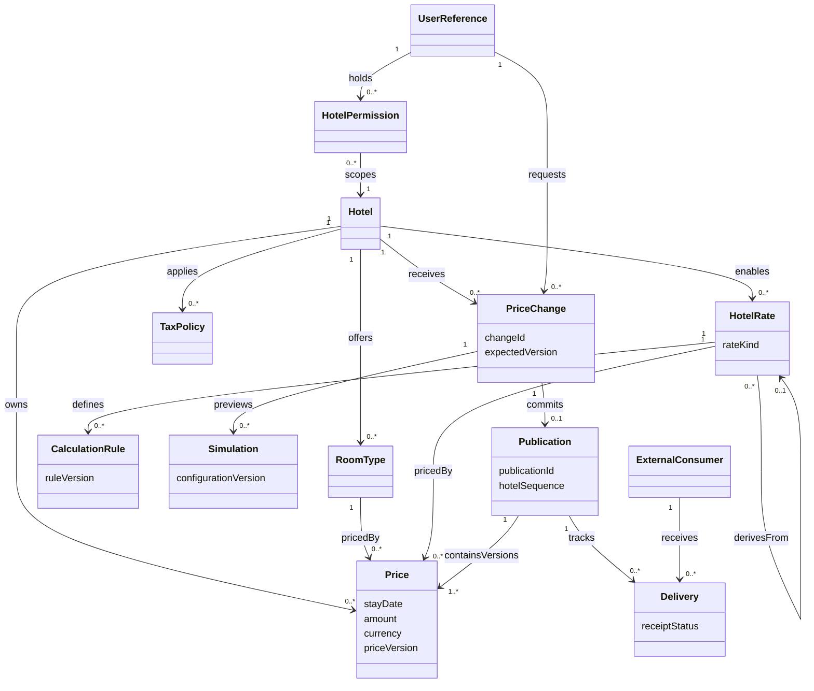

| Element | Responsibility and invariant |
|---|---|
| Hotel | Configuration, permissions and integration ordering scope. |
| RoomType | Hotel-owned category; no cross-hotel price references. |
| HotelRate | Base, fixed or derived rate. Derived dependencies are acyclic; only base/fixed values are directly edited. |
| CalculationRule | Versioned, validated decimal expression using approved operations; no arbitrary executable scripts. |
| TaxPolicy | Versioned tax configuration; inclusive/exclusive treatment must be explicit. |
| Price | Immutable historical value for hotel/date/room/rate; current rows point to a committed version. |
| PriceChange | One hotel/date command with expected price and configuration versions and an idempotency key. |
| Simulation | Same calculation engine and explicit input versions as commit, with no price/outbox writes. |
| Publication | Exactly one per committed child change; contains the complete resulting hotel/date price matrix. |
| Delivery | One logical delivery per publication/destination with multiple durable attempts and receipt evidence. |
| ExternalConsumer | Authorized query consumer or publication recipient, with a contract-specific adapter. |
| UserReference | Provider identity subject; credentials stay at the identity provider. |
| HotelPermission | Subject, hotel and operation grants, changed only by an authorized administrator. |

Configuration edits create drafts. Existing published prices retain their calculation/configuration version. Activating changed tax/rate/room configuration schedules explicit child recalculations for the selected effective dates; it does not silently reinterpret stored amounts. Removed rates are retired prospectively and remain in historical publications. Whether activation must be atomic across all dates is unresolved; the baseline reports per-date activation progress.

### 5.- Container diagram

The Java application is a modular codebase. Command and query deployments use the same artifact with distinct runtime roles and database privileges; the worker is a separate deployable from the same repository. A single owned database supports local transactions without permitting integration through shared tables.

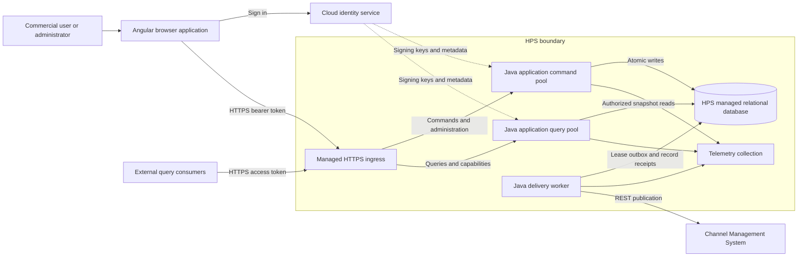

| Container | Responsibilities | State and failure behavior |
|---|---|---|
| Angular UI | Login redirect, configuration, simulation, edits, queries, status and permitted navigation. | Tokens in memory; no authoritative pricing or permission state. Reload may require SSO. |
| HTTPS ingress | TLS, routing, request limits and coarse rate limits. | Managed redundant ingress; never the sole authorization layer. |
| Command pool | Validate/authenticate, authorize, configure, calculate and atomically publish. | Stateless processes; authoritative state in DB. Database failure prevents acceptance. |
| Query pool | Browser/external queries and capability discovery through shared query port. | Independently scaled, bounded read connections; no CMS dependency. |
| Managed relational DB | Configuration, grants, current prices, immutable publications, idempotency results, outbox and receipts. | Private access, encrypted backups, synchronous HA option subject to provider validation. |
| Delivery worker | Ordered per-hotel delivery, retries, acknowledgements and reconciliation. | Renewable leases plus durable records; worker restart does not discard pending work. |
| Telemetry collector | Operational metrics/logs/traces and export reconciliation. | Not required for price query execution; durable business records repair export gaps. |

#### Production deployment refinement

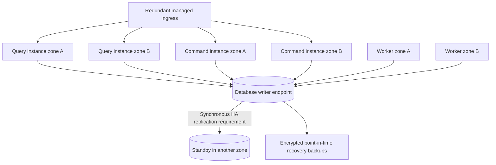

Use at least two query instances across failure zones for production. The managed database must provide fenced failover and a writer endpoint. Synchronous commit with the intended durability semantics must be verified on the chosen service, not inferred from the word managed. Read replicas and price caches are deferred so a successful change is immediately visible on subsequent primary reads. Query/worker/command connection quotas protect the database from one workload exhausting all connections.

An illustrative 30-day eligible period permits 43.2 minutes of unavailability at 99.9%. The actual SLA period and maintenance rules remain open. Provisional engineering goals are recovery within five minutes after a single-zone/database failover and zero lost acknowledged changes in that failure model; region-wide disaster RTO/RPO require a separate business decision and recovery exercise. Do not claim these goals have been achieved.

### 6.- Component diagrams

#### Java application components

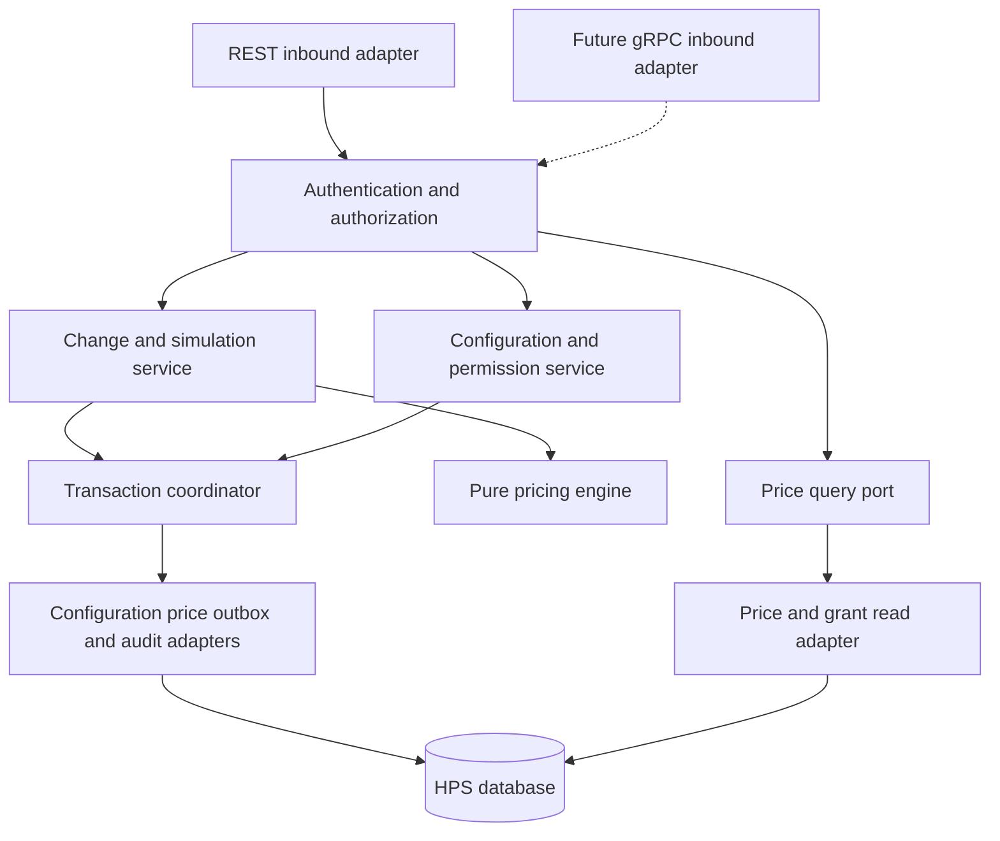

| Component | Responsibility |
|---|---|
| REST adapter | Versioned HTTP contracts, validation and domain-error mapping; no pricing rules. |
| Authentication/authorization | Verify token signature, issuer, audience and expiry; check current DB grants for every hotel and operation. |
| Change/simulation service | Load versioned inputs, call engine, validate concurrency and coordinate commits. |
| Pure pricing engine | Deterministic decimal calculation; same code for simulation and publication; no HTTP, DB or provider SDK dependencies. |
| Query port | Transport-neutral request/result objects and mandatory principal context. |
| Configuration/permission service | Draft/version hotel and rate settings; administer grants with audit history. |
| Transaction coordinator | Own atomic writes and lock ordering; adapters do not independently commit parts of a change. |
| Persistence adapters | Implement application ports; indexes and SQL are confined here. |

Dependencies point inward to domain/application interfaces. Build checks reject core imports of HTTP, gRPC, identity-provider or persistence adapter packages. A future gRPC adapter supplies authenticated principal context and maps the existing query result; it cannot bypass hotel authorization.

#### Delivery worker components

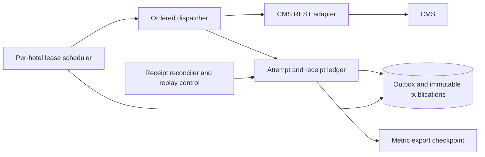

| Component | Responsibility |
|---|---|
| Lease scheduler | Acquire an expiring hotel/destination lease; never hold a database transaction open during HTTP calls. |
| Ordered dispatcher | Send the earliest unacknowledged sequence for that hotel; other hotels continue independently. |
| CMS REST adapter | Translate envelope, authenticate with a secret-store credential, apply bounded timeouts and interpret receipts. |
| Ledger | Persist attempt start/result, acknowledgement identifiers and retry scheduling. |
| Reconciler/replay control | Resolve uncertain receipts, detect missing deliveries, replay exact immutable payloads with the same publication ID. |
| Metric exporter | Resume from a durable checkpoint and deduplicate exported records. |

Lease ownership alone cannot prevent a paused worker's late HTTP request after lease expiry. CMS deduplication by publication ID and rejection of older hotel sequences are required for safe automatic recovery. If CMS cannot support these, ambiguous delivery enters reconciliation and blocks that hotel's later deliveries; the QA-2 guarantee remains conditional.

#### Browser components

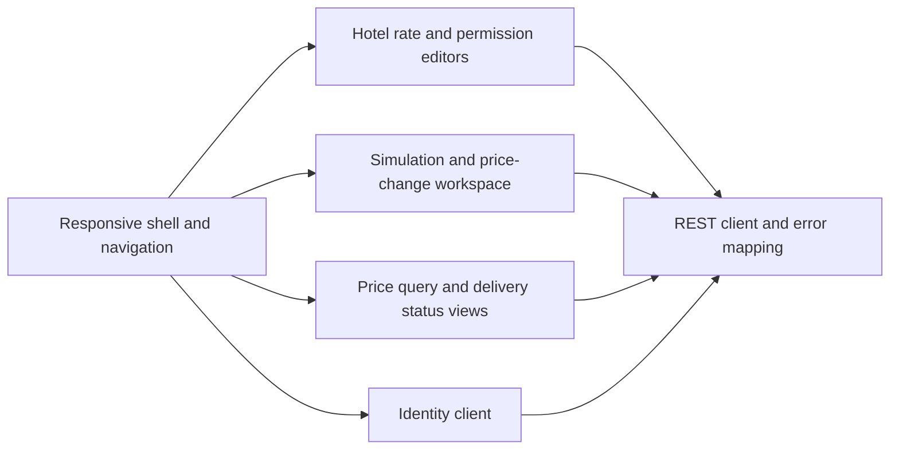

| Component | Responsibility |
|---|---|
| Shell/identity client | Federated session, capability-driven navigation and logout. |
| Editors | Versioned administration forms and conflict handling. |
| Pricing workspace | Display simulation provenance, require refresh after conflict, show per-date commit outcomes. |
| Query/status views | Distinguish authoritative query publication from pending CMS receipt. |
| REST client | Attach token and correlation ID, retain idempotency key on retry, map validation/auth/conflict errors. |

### 7.- Sequence diagrams

#### S1 - Login and authorized access: HPS-1, QA-5

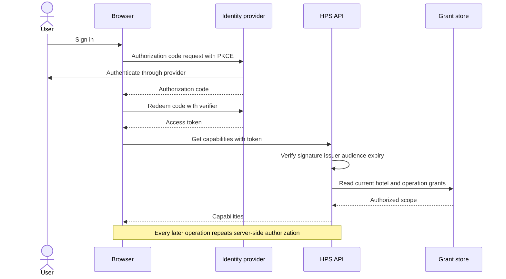

Use authorization code with PKCE and exact registered redirects; browser code does not hold a client secret. This choice follows the security guidance in [RFC 9700](https://www.rfc-editor.org/rfc/rfc9700.html). Provider compatibility and token revocation behavior require integration validation. Tokens are not written to logs or persistent browser storage. Machine callers use provider-issued workload credentials with explicit hotel/query grants. Local signature verification uses cached keys with rotation refresh; unknown keys or expired tokens fail closed. Existing valid tokens can continue during an identity outage; new logins cannot.

#### S2 - Simulation and atomic publication: HPS-2, QA-1, QA-2

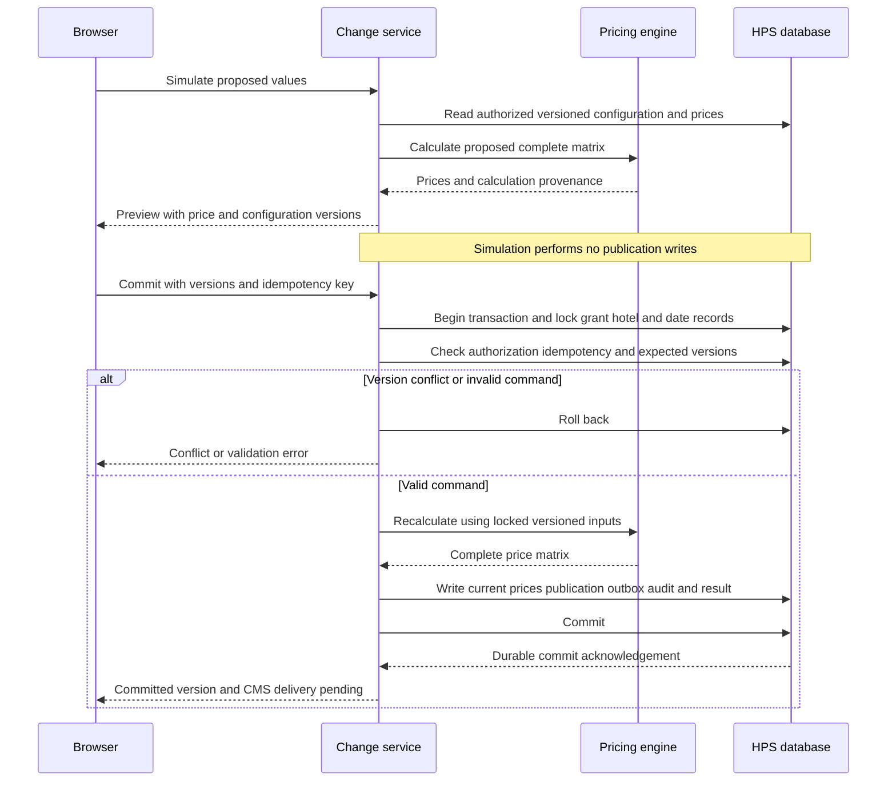

A successful response means query-visible commit, not CMS receipt. A timeout after commit is resolved by retrying with the same idempotency key or reading change status. Queries return a complete pre-change or post-change matrix, never a partly updated matrix. A new query begun after acknowledgement reads the committed version or a later one.

#### S3 - Queries and scale: HPS-3, QA-3, QA-4

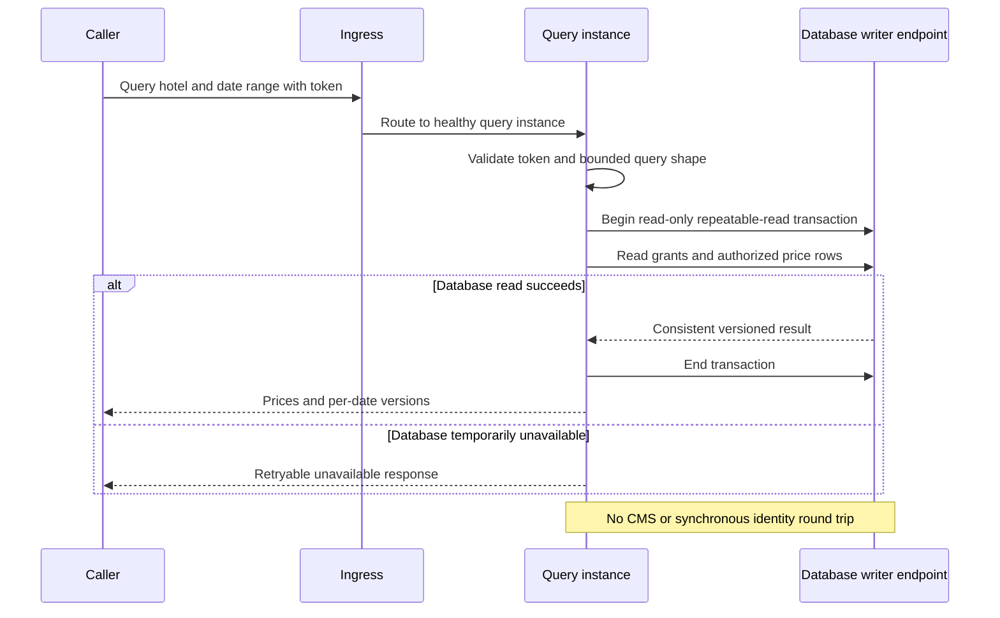

The database adapter uses a single consistent read transaction for grants and result rows. PostgreSQL's documented repeatable-read semantics provide a stable transaction snapshot; successive statements at read committed can observe different snapshots. This motivates the selected read boundary, not a claim that snapshot isolation alone enforces all write invariants. See [PostgreSQL transaction isolation](https://www.postgresql.org/docs/18/transaction-iso.html). Pagination across separate calls is explicitly not an atomic multi-page snapshot; clients needing one must use a bounded single response or a separately designed export.

#### S4 - Administration: HPS-4, HPS-5, HPS-6

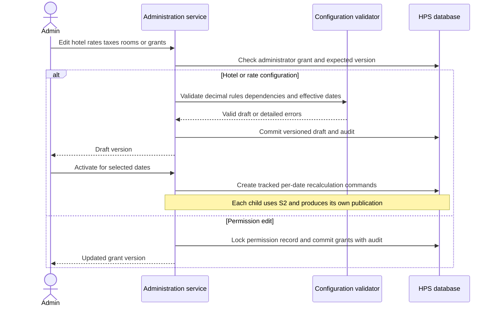

Permission checks for writes acquire compatible grant locks until commit; revocations use conflicting locks. Thus a revocation takes effect after any already-authorized transaction completes, and later writes see the new grants. Queries authorize at transaction start; a query already in progress may finish. No permission cache is used initially. Changes to provider-level identity lifecycle remain with the identity service; HPS-6 edits application grants.

#### S5 - Durable delivery and recovery: QA-2, QA-8

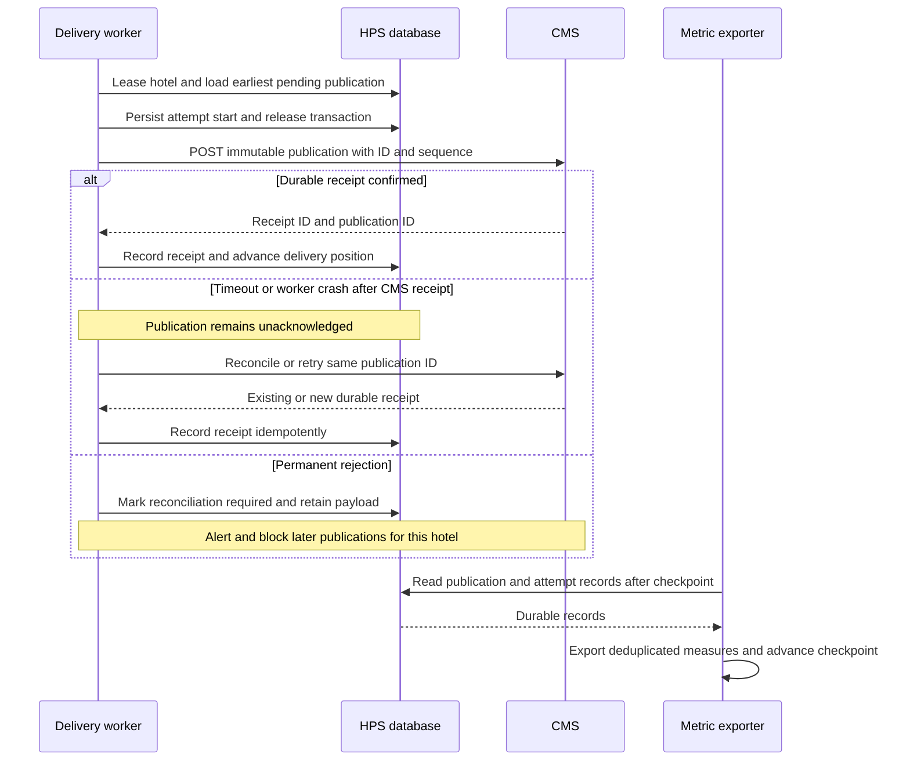

Atomic price/outbox persistence avoids the gap between committing prices and scheduling their delivery. Duplicate transmissions remain possible and must be handled by the recipient or reconciliation protocol. This is the core rationale of the [transactional outbox pattern](https://docs.aws.amazon.com/prescriptive-guidance/latest/cloud-design-patterns/transactional-outbox.html); the HPS-specific ordering and receipt policies above are design choices, not provider guarantees.

#### S6 - Failure isolation and failover: QA-3

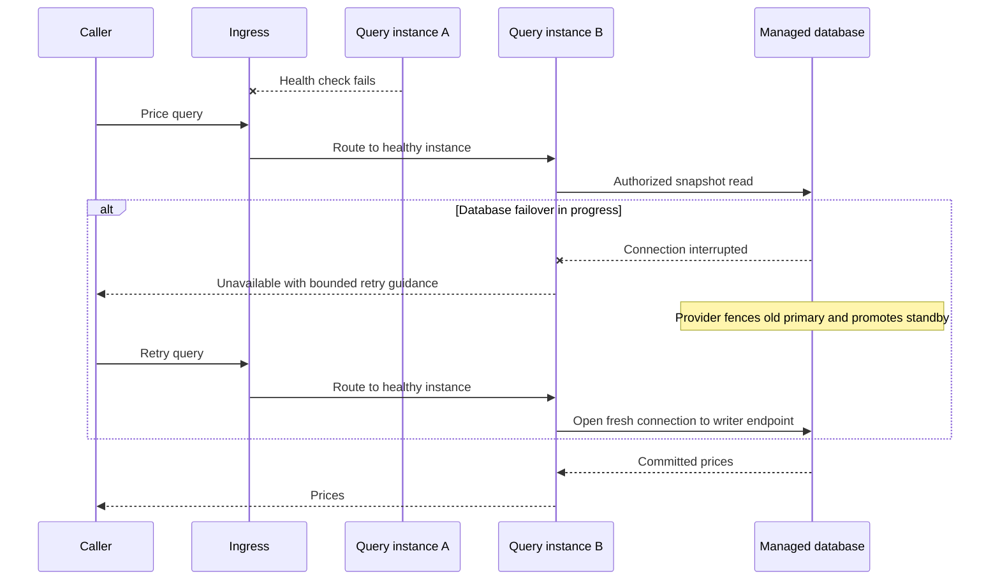

Failover can create downtime and counts against the query availability budget; redundancy does not imply zero interruption. Queries do not silently return stale fallback prices. CMS circuit opening pauses delivery only. Database connection recovery, readiness checks and retry budgets must be tested under load.

#### S7 - New query protocol: QA-6

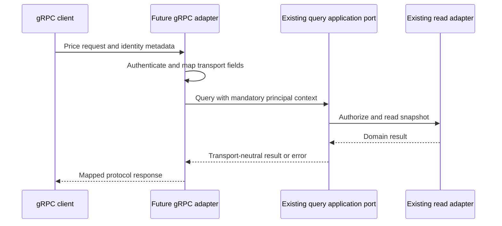

Only adapter, dependency wiring, packaging and protocol tests change. The query service, authorization policy and domain model remain untouched. This is an extension test to perform during implementation, not an already delivered gRPC endpoint.

#### S8 - Promotion and independent tests: QA-7, QA-9, CRN-5

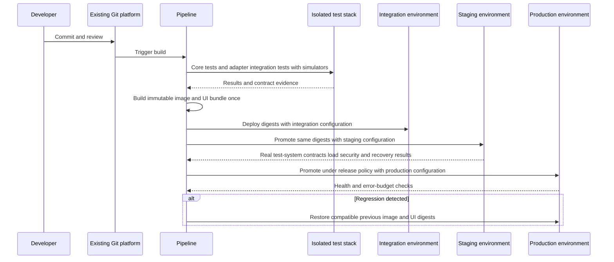

The Angular bundle loads an environment configuration document at startup rather than embedding environment URLs at build time. Secrets are injected at runtime and never included in that public document. Cloud test doubles support disconnected integration tests; staging validates the assumptions those doubles cannot establish. This diagram defines the future pipeline, not authorization to deploy anything in this task.

### 8.- Interfaces

#### Public REST contracts

All routes use HTTPS and `/v1`. Token validation and hotel/operation authorization apply to every route, including status and simulation. Monetary values are decimal strings with explicit currency; dates are hotel-local ISO dates. Unknown fields and rule operations are rejected under a documented schema policy. The initial supported currency/tax/rounding policy must be explicit in configuration; no silent default is invented here.

| Interface | Request and result | Consistency and errors |
|---|---|---|
| `GET /v1/me/capabilities` | Subject-derived hotel/operation grants; identity comes only from validated token. | No client-supplied subject override. |
| `POST /v1/hotels/{hotelId}/simulations` | Date, base/fixed edits, expected configuration version; returns calculated matrix and input versions. | No price or delivery effects; preview is not a reservation or committed price. |
| `POST /v1/hotels/{hotelId}/price-changes` | One date, edited base/fixed values, expected price/config versions; `Idempotency-Key`. Returns 201 with change ID, committed version and delivery status. | Successful only after atomic commit. Identical replay returns stored result; reused key with different body returns 409. |
| `GET /v1/hotels/{hotelId}/changes/{changeId}` | Authoritative commit and CMS receipt state. | Resolves uncertain HTTP outcomes; no cross-hotel information leakage. |
| `GET /v1/hotels/{hotelId}/prices` | Bounded date range and optional room/rate filters; returns versioned prices and currency/tax metadata. | Current primary snapshot; 422 for excessive query shape; no fabricated prices for missing dates. |
| `POST /v1/hotels` and `PUT /v1/hotels/{hotelId}/draft` | Hotel metadata, taxes, rooms and enabled rates; draft/version result. | Administrator only, version precondition on update. |
| `PUT /v1/hotels/{hotelId}/rates/{rateId}/draft` | Validated base/fixed/derived definition and calculation rule. | Cycle, missing dependency and unsupported operation checks. |
| `POST /v1/hotels/{hotelId}/configuration-activations` | Draft version and effective dates; operation ID with per-date outcomes. | No promise of all-date atomicity; each child uses the pricing transaction. |
| `PUT /v1/users/{subjectId}/hotel-permissions/{hotelId}` | Operation grants with current permission version. | Administrator scope enforced; audited update. |

For multi-date price edits, the UI coordinates individual child requests and displays partial outcomes explicitly. A future bulk endpoint must preserve child IDs and idempotency semantics. QA-1 covers the original single-date scenario; a large date range cannot silently inherit its 100 ms promise.

Error vocabulary: 400 malformed input; 401 invalid/expired identity; 403 insufficient scope; 404 missing resource within authorized scope; 409 stale version/idempotency mismatch; 422 invalid pricing rules or bounds; 429 quota exceeded; 503 unavailable dependency. Responses include a correlation ID and safe error code, never tokens or SQL details. A 503 or transport timeout does not prove a write failed; clients resolve it using the original idempotency key.

#### Application ports and transaction boundary

| Port | Contract |
|---|---|
| `PriceQuery` | Principal context plus bounded hotel/date filters to versioned result; authorization mandatory regardless of transport. |
| `PriceCalculation` | Explicit versioned inputs to deterministic result or domain validation errors; no I/O. |
| `PriceChange` | Principal, expected versions, edits and idempotency key to committed publication identity. |
| `Configuration` | Draft validation and explicit activation commands, retaining prior versions. |
| `PermissionPolicy` | Current subject/hotel/operation grants, with write/revocation serialization. |
| `PublicationStore` | Atomic price, publication, audit, idempotency-result and outbox writes. |
| `CMSDelivery` | Immutable envelope to confirmed receipt, retryable error, permanent error or unknown outcome. |

Write lock order is permission record, hotel control record, then hotel/date state; administration follows the same order when it touches multiple scopes. A hotel control lock serializes publication sequence assignment and configuration activation. This sacrifices same-hotel write concurrency for a simple ordered baseline; different hotels proceed independently. Lock timeout, request size and transaction duration are bounded. Recalculation must not perform network calls while holding locks.

The unique idempotency key scope is subject, hotel and operation. Store request hash and original result in the same commit. A duplicate is checked before comparing old expected versions; it returns the original authorized result instead of an artificial conflict. Retention must exceed the agreed retry/replay window; baseline 90 days is a proposal. Retain key tombstones after removing full results so expired replay keys can be explicitly rejected rather than treated as new commands; final tombstone retention requires an agreed client retry envelope. Current prices use a composite key of hotel/date/room/rate. Immutable publication payloads avoid reconstructing an older delivery from newer prices.

#### CMS publication contract and recovery

Envelope fields: `schemaVersion`, `publicationId`, `changeId`, `hotelId`, `hotelSequence`, `stayDate`, `priceVersion`, `configurationVersion`, `occurredAt`, `correlationId` and complete price rows with currency and tax metadata. The adapter maps this internal envelope to the existing CMS API; the actual CMS route and authentication mechanism remain unknown.

Require CMS durable receipt identification and duplicate recognition by publication ID. If it replies 202, delivery is pending until receipt polling or a verified callback confirms acceptance. HTTP 200 alone is not interpreted as proof without the agreed CMS contract. Do not coalesce away intermediate publications: QA-2 requires every accepted change to reach CMS, even if a later price supersedes it. Version/sequence checks prevent old retries from overwriting newer CMS state.

States are `PENDING`, `IN_FLIGHT`, `RETRY_WAIT`, `ACKNOWLEDGED`, and `RECONCILIATION_REQUIRED`. Expired leases recover to retry/reconciliation. Proposed retry schedule uses exponential backoff with jitter from one second to a five-minute cap; honor valid `Retry-After` limits. Alert on oldest unacknowledged age above five minutes, subject to the eventual business delivery SLO. Permanent payload errors are retained and block only that hotel's stream; an operator repairs the adapter or mapping and replays the same immutable change. Never delete or label a record successful solely because retries were exhausted.

| Failure point | Recovery and invariant |
|---|---|
| Before database commit | Entire change rolls back; it was not accepted. |
| After commit, before HTTP response | Same key returns stored result; no duplicate price change. |
| Worker fails before send | Lease expires; another worker resumes pending record. |
| CMS receives, acknowledgement lost | Duplicate-safe retry or receipt lookup; retain unknown state otherwise. |
| Worker fails after receipt but before ledger write | Same publication ID reconciles to the same CMS receipt. |
| CMS outage | Prices stay queryable; durable backlog grows, with disk/capacity alerting and admission limits before storage exhaustion. |
| Region-wide data loss beyond backup coverage | Outside provisional zero-loss failure model; requires agreed disaster RPO and tested restoration/reconciliation. |

#### Performance and capacity model

Proposed QA-1 boundary is ingress receipt to durable commit on the writer, when prices are query-visible; browser transit and CMS receipt are separate measures. Record both the full observed distribution and maximum; use p99 below 100 ms as a provisional engineering target only, since the requirement does not specify a percentile and may require a stricter bound.

| Single-date internal budget | Proposed allocation |
|---|---|
| Ingress, token validation and dispatch | 10 ms |
| Grant/configuration reads and locks | 15 ms |
| Deterministic price matrix calculation | 20 ms |
| Price/publication/outbox writes and durable commit | 35 ms |
| Contingency | 20 ms |

Total is 100 ms with a strict target below that ceiling; these are allocation hypotheses, not measurements. Synchronous HA replication, payload size and hot-hotel locks are the main risks. Test across maximum supported rates, room types and rule complexity before choosing request bounds. Bounded compiled rule caching may be keyed by immutable configuration version; caching current prices is deferred.

100,000 queries/day averages about 1.16 queries/s; 1,000,000 averages about 11.57 queries/s. Neither establishes peak capacity. Provisional peak tests use 10x these averages, about 12 and 116 queries/s, plus a 250 queries/s burst, with identical payload and hotel distributions and simultaneous writes. At each workload report mean, p95, p99, throughput, errors and database saturation. Check high-volume mean against 1.2 times baseline only under the provisional QA-4 interpretation; define an absolute latency SLO as well so two equally slow runs cannot pass operational acceptance.

Scale query instances on measured CPU, queueing and latency while capping total database connections. Load-test indexes for hotel/date lookups and grant checks before considering partitioning or read replicas. Measure hot-hotel distributions, large date ranges, empty results and authenticated-denied calls separately. Request throttling above agreed capacity is explicit and cannot be counted as successful throughput.

#### Observability and environment interfaces

Durable publication rows record change ID, acceptance/commit timestamps, version and expected destinations. Attempt rows record attempt ID, start/end, result, CMS receipt and error classification; an interrupted attempt remains identifiable as unknown. The exporter uses a checkpoint and stable IDs to recover missing exports and avoid double counting. Unsampled committed-publication records support count reconciliation; sampled traces supplement rather than prove 100% coverage. Reconcile accepted changes = query-visible publications = pending plus acknowledged destination records within the defined retention window. Correct for multiple destinations if introduced.

Measure ingress-to-commit latency, observed query visibility, delivery age and completion latency, retries, reconciliation backlog, per-route query errors/latency and dependency health. Never use hotel IDs as unbounded metric labels; put detailed correlation in protected logs/records. Noncommitted request latency comes from ingress/app metrics; 100% end-to-end measurement during total infrastructure loss cannot be assumed and remains an acceptance limitation.

Runtime configuration includes URLs, limits, timeout budgets, database pools, key metadata locations and telemetry destinations. Secrets come from the cloud secret store under workload identities; DB roles are read-only for query instances and narrowly scoped for command/worker roles. Database, backup and network access remain private except the managed ingress. Telemetry must redact credentials and minimize personal data.

### 9.- Design decisions

| ID / iteration | Driver | Decision | Rationale | Discarded alternatives |
|---|---|---|---|---|
| D01 / 1 | CRN-1, CRN-2, CON-4 | Angular plus modular Java application and separate delivery worker. | Fits team skills and local transactional workflow within early delivery constraints. | Many independently owned services introduce distributed data/operations before evidence justifies them. |
| D02 / 1 | QA-6, QA-9, CON-5 | Ports and adapters with REST at the edge. | Separate protocol and provider changes from pricing behavior. | Framework/HTTP types in core make protocol extension invasive. |
| D03 / 1 | HPS-2, HPS-3, HPS-4, CON-2, CON-6 | One HPS-owned managed relational store; PostgreSQL-compatible behavior is the reference. | Transactions and versioned configuration fit the domain; no external table access. | External shared database perpetuates coupling; multiple stores add dual-write problems. |
| D04 / 2 | HPS-2, QA-1 | Synchronous complete hotel/date calculation and atomic price visibility. | Avoids eventual query projection delay and partial matrices. | Async calculation cannot establish query readiness at acknowledgement; calculate-on-query increases read cost. |
| D05 / 2 | HPS-1, HPS-6, QA-5 | Federated login and current server-side hotel/operation grants. | Provider owns credentials; authorization survives UI bypass attempts. | UI-only permissions and long-lived token-only hotel grants permit unauthorized access or stale revocation. |
| D06 / 2 | HPS-4, HPS-5, CRN-4 | Versioned configuration, constrained decimal rules and explicit activation. | Simulation provenance and repeatable historical prices. | Arbitrary scripts and implicit recalculation make correctness difficult to audit. |
| D07 / 2 | HPS-2, QA-2 | Expected versions, idempotency and serialized hotel publication sequence. | Reject stale edits and resolve uncertain responses without duplicate changes. | Last-write-wins and blind HTTP retries can lose user intent. |
| D08 / 3 | QA-2, CON-5 | Transactional outbox with direct worker-to-CMS REST delivery. | Durable handoff without synchronous CMS dependency or mandatory broker. | DB-plus-network dual write can lose delivery; broker alone does not make price/outbox commit atomic. |
| D09 / 3 | QA-2, QA-8 | Immutable payloads, per-hotel ordering, receipt reconciliation and durable attempt ledger. | Preserve every accepted change and repair unknown outcomes. | Coalescing intermediate updates conflicts with QA-2; retry exhaustion deletion loses changes. |
| D10 / 4 | QA-3, QA-4, QA-1 | Separate stateless query pool, zone redundancy and primary reads. | Scale reads and isolate application resources while preserving immediate visibility. | Async read replicas/caches introduce freshness trade-offs; separate query datastore adds propagation delay. |
| D11 / 4 | QA-3, QA-2 | Managed fenced DB failover with validated synchronous durability and tested backups. | Protect accepted state across defined failures. | Single-zone DB is a common failure point; active-active regional writes add conflict complexity. |
| D12 / 5 | QA-7, CON-3, CRN-5 | Build once on existing Git platform, promote immutable digests with runtime config. | Reproducible movement between all environments. | Environment-specific rebuilds and branches obscure artifact equivalence. |
| D13 / 5 | QA-9, QA-6 | Adapter contract suites, local dependency stack and protocol-extension test. | All elements test without live external systems; staging checks real compatibility. | Mock-only testing cannot establish external protocol compatibility. |
| D14 / 5 | QA-8, CRN-4 | Durable metric source and export reconciliation, plus health/latency telemetry. | Recover publication evidence after collector outage. | Sampled traces alone cannot establish complete publication accounting. |
| D15 / 5 | CON-4, CRN-3, CRN-4 | Assign responsibility areas and use reversible expand/contract migrations and staged cutover. | Limit delivery risk and avoid two active price writers. | Big-bang migration without shadow comparison or rollback evidence. |

#### Operations and release procedure

Build gates include core invariant tests, module dependency checks, schema/contract compatibility, security scanning and adapter integration suites. Promote a signed/identified image digest and UI digest through integration, staging and production; inject only runtime configuration. Deployment health checks exercise a scoped synthetic price query. Use a small initial production traffic share and monitor error budget before completing rollout, under the organization's release policy.

Use expand/contract database migrations: add compatible schema first, deploy code tolerant of both versions, backfill with checkpoints, then remove old schema only after the rollback window. Rollback restores application/UI artifacts, not destructive reverse migrations. Keep worker/event schemas backward compatible while old publications remain outstanding. When business data needs correction, create audited compensating price changes; never restore an old whole database merely to roll back code.

Legacy cutover: inventory consumer contracts, map/import hotel/rate/permission and price state, compare representative calculations, shadow-read new queries, then freeze legacy writes for final reconciliation. Switch to a single HPS write authority and explicitly transfer pending-delivery ownership before enabling new worker sends. Prevent duplicate CMS publication during overlap. Rollback to legacy requires reconciling changes accepted by the new system; a traffic switch alone is insufficient. Migration feasibility and legacy export access are open dependencies.

| Responsibility area | Deliverables | Collaboration boundary |
|---|---|---|
| Front end | Responsive workflows, capability UI, conflicts and delivery status. | Agree contracts with application owners. |
| Domain/application | Rules, configuration lifecycle, transaction semantics and query port. | Own invariant and calculation examples. |
| Integration/security | Identity adapter, grants, CMS contract and receipt recovery. | Obtain provider/CMS contract evidence. |
| Platform/quality | Environments, pipeline, load/failure suites, telemetry and runbooks. | Validate operational targets and release evidence. |

Named staff and capacity are unspecified; these are work packages, not headcount commitments. Revisit the modular baseline if measured hot-hotel lock waits exceed the latency budget, database saturation persists after indexing/tuning, delivery destinations multiply, or independently owned teams need independent releases. A broker may then help fan-out, but does not replace the atomic publication record.

#### Final assessment and remaining evidence

All five ADD design iterations have been executed. **Satisfied** below means sufficient design decisions exist for the stated architectural intent; it does not mean a deployed system passed acceptance. **Partially satisfied** means remaining business/contract detail or design validation can materially change the decision. No runtime tests were possible because this task produced architecture documentation, not an implementation.

| Driver | Final analysis result | Evidence still required |
|---|---|---|
| HPS-1 | Satisfied at design level: S1 and D05. | Provider login, expiry, key rotation and outage tests. |
| HPS-2 | Partially satisfied: S2/S5, D04/D07-D09. | Calculation policies, multi-date atomicity expectations and CMS receipt compatibility. |
| HPS-3 | Satisfied at design level: S3, D02/D10. | Query contract and consistency tests. |
| HPS-4 | Partially satisfied: S4 and versioned activation. | Tax treatment and activation semantics. |
| HPS-5 | Partially satisfied: constrained versioned rules. | Approved rule vocabulary, rounding and effective dates. |
| HPS-6 | Satisfied at design level: scoped grant editing and audit. | Administrator policy, revocation and negative tests. |
| QA-1 | Partially satisfied: atomic primary publication and budget. | Timing/percentile/workload agreement and measured worst-case matrix/lock behavior. |
| QA-2 | Partially satisfied: durable outbox and receipt recovery. | CMS idempotency/ordering/receipts, retention and recoverable-failure scope. |
| QA-3 | Partially satisfied: redundant query tier and database failover. | Provider configuration, SLA period and measured failover/recovery. |
| QA-4 | Partially satisfied: independent query scaling and workload plan. | Corrected target, peak profile, absolute latency SLO and paired load tests. |
| QA-5 | Satisfied at design level: federated identity and enforced grants. | Identity protocol fit, security testing and revocation-policy acceptance. |
| QA-6 | Satisfied at design level: S7 and dependency rule. | Implement second adapter and verify unchanged core. |
| QA-7 | Satisfied at design level: S8 and runtime config. | Promote identical digests across nonproduction environments. |
| QA-8 | Partially satisfied: durable metrics and reconciliation. | Agreed measure inventory/retention and collector-crash completeness test. |
| QA-9 | Satisfied at design level: ports and complete test-element inventory. | Execute all independent suites plus external staging contracts. |
| CON-1 | Satisfied at design level: responsive browser client. | Browser/device matrix tests. |
| CON-2 | Satisfied at design level: cloud/provider identity boundary. | Confirm existing provider services and integration support. |
| CON-3 | Satisfied at design level: existing Git platform pipeline. | Repository/pipeline configuration. |
| CON-4 | Partially satisfied: staged two/six-month plan. | Staffing, scope and legacy-integration estimates. |
| CON-5 | Satisfied at design level: initial REST adapters. | Existing consumer and CMS contract verification. |
| CON-6 | Satisfied at design level: managed runtime/state and external config. | Provider sizing and cost review. |
| CRN-1 | Satisfied: container/component/deployment views. | Implementation conformance review. |
| CRN-2 | Satisfied: Java/Angular allocation. | Team framework/version selection. |
| CRN-3 | Partially satisfied: defined work packages. | Named owners and capacity allocation. |
| CRN-4 | Partially satisfied: boundaries, decisions and debt triggers. | Resolve listed assumptions and enforce checks during development. |
| CRN-5 | Satisfied at design level: pipeline and rollback design. | Implement and rehearse pipeline. |

The detailed experiment inventory and unresolved acceptance decisions are maintained in [validation-plan.md](validation-plan.md). Complete documentation is the outcome of this task; operational SLA achievement remains unproven.
